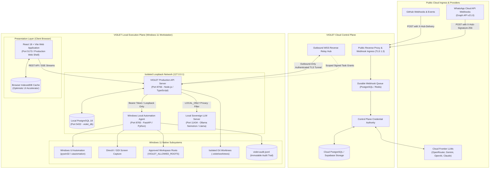
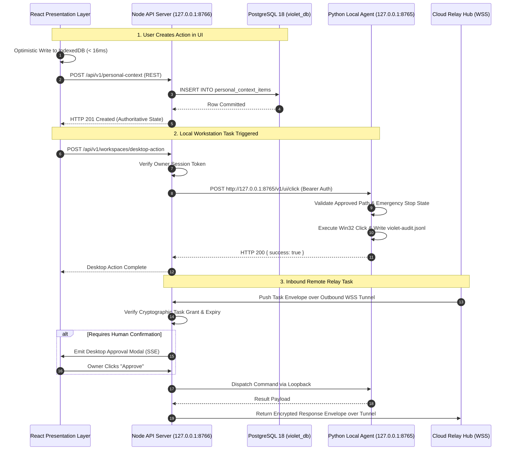

# VIOLET — High-Level Design (HLD)

**Document Title:** VIOLET: Sovereign Personal AI Operating System — High-Level Design  
**Document Version:** 1.0.0  
**Status:** APPROVED ARCHITECTURAL SPECIFICATION  
**Target Release:** Production Hybrid Platform  
**Author:** Principal Software Architect, Staff Backend Engineer, Distributed Systems Engineer  
**Date:** 2026-11-24  

---

## 1. System Architecture & Topology

VIOLET is engineered around a **Hybrid Split-Plane Topology** that balances workstation sovereignty with cloud availability:



---

## 2. Core Architectural Subsystems

### 2.1 Production Node.js API Server Subsystem
- **Purpose:** Central coordinator for local business logic, local database interactions, multi-model AI routing, and integration connectors.
- **Runtime:** Node.js 20+ with TypeScript, running as a standalone server process (`src/server/main.ts`) decoupled from Vite development middleware.
- **Port:** `127.0.0.1:8766`.
- **Key Modules:**
  - `violetApiServer.ts`: Request router, HTTP dispatcher, SSE event streaming.
  - `auth/`: Local authentication, Argon2id password hashing, session manager, singleton owner bootstrap.
  - `integrations/`: Universal integration hub, provider catalog, credential vaulting.
  - `chat/`: Conversation threads, chat sessions, message lifecycle.
  - `knowledge/`: Text and vector knowledge items, indexing, semantic reference linking.
  - `personalContext/`: Real-time contextual reflections, extracted goals, tasks, and follow-ups.
  - `workspace/`: Workspace collections, worktree execution bindings.
  - `audit/`: Append-only audit logger committed to PostgreSQL.

### 2.2 Local Windows Automation Agent Subsystem
- **Purpose:** Privilege-controlled daemon executing desktop-level actions on the primary Windows 11 machine.
- **Runtime:** Python 3.12+ with FastAPI, running under Uvicorn.
- **Port:** `127.0.0.1:8765` (Hardcoded strictly to loopback).
- **Core Services:**
  - `ScreenCaptureService`: High-speed desktop and region screenshot capture.
  - `WindowManagerService`: Windows enumeration, focus, minimize, maximize via Win32.
  - `UIAutomationService`: Accessibility tree parsing and element bounding-box discovery.
  - `InputControllerService`: Smooth mouse movement, clicks, keyboard typing, hotkey dispatch.
  - `VisualGroundingService`: Coordinates screen capture with AI element localization.
  - `ProcessManagerService`: Safe application launching and process list auditing.
  - `EmergencyStopService`: Global keyboard listener (`Ctrl+Alt+Shift+Escape`) terminating input automation instantly.

### 2.3 Universal Integration Control Plane Subsystem
- **Purpose:** Standardized interface for third-party services.
- **Design Pattern:** Strategy / Adapter pattern implementing `UniversalConnector`:
  - `WhatsAppBusinessConnector`: Official Meta WhatsApp Cloud API v21.0.
  - `GitHubUniversalConnector`: GitHub REST & GraphQL API for issues, repos, and PRs.
  - `GmailUniversalConnector`: Google Workspace Gmail API.
  - `GoogleDriveUniversalConnector`: Google Drive API for cloud file indexing.
- **Security Invariants:**
  - Credential Vault: Versioned envelope encryption (`AES-256-GCM` + `HKDF-SHA256`).
  - Zero Secret Exposure: Secrets are scrubbed from JSONB metadata and redacted from client API responses.
  - Raw-Byte Webhook Verification: HMAC-SHA256 calculated over the exact original byte buffer.

### 2.4 Multi-Model Intelligence Gateway Subsystem
- **Purpose:** Intelligent routing, privacy enforcement, and execution across local and cloud LLM providers.
- **Core Engine:**
  - `ModelGateway`: Main coordinator handling chat requests, streaming chunks, and fallbacks.
  - `IntelligentModelRouter`: Routes based on model capabilities, context window, latency, cost, and privacy policy.
  - `HardwareResourceManager`: Monitors workstation GPU/VRAM leases for local Ollama models.
  - `CircuitBreaker`: Isolates failing providers to prevent cascade timeouts.
- **Privacy Gating:** Requests tagged with `LOCAL_ONLY` policy strictly route to local Ollama; remote cloud candidates are filtered out at the routing step.

### 2.5 Multi-Agent Autonomous Engineering Lab Subsystem
- **Purpose:** Multi-agent collaboration performing complex software engineering tasks without human micromanagement.
- **Roles:**
  - **Architect Agent:** High-level system design, file impact analysis, task decomposition (DAG generation).
  - **Developer Agent:** Code implementation, refactoring, unit test generation.
  - **Reviewer Agent:** Static analysis, AST security checks, automated test execution, code review verdict.
- **Isolation:** Edits take place strictly within Git worktrees (`.violet/worktrees/{agent_id}`). Main branch working directories are never polluted.

---

## 3. Data Flow & Communication Architecture



---

## 4. Subsystem Interfaces & Protocols

| Subsystem A | Subsystem B | Protocol | Authentication / Security | Payload Format |
| :--- | :--- | :--- | :--- | :--- |
| **Browser UI** | **Node API Server** | HTTP/1.1 REST & SSE | HTTP-Only SameSite Cookies / Bearer JWT | JSON / UTF-8 Text |
| **Node API Server** | **Local PostgreSQL 18** | Native TCP (Port 5432) | Role Password (`violet_app`) / Prepared Statements | Binary Protocol (`pg`) |
| **Node API Server** | **Python Local Agent** | HTTP/1.1 (Port 8765) | Bearer Token (`VIOLET_API_TOKEN`) / Loopback Only | JSON |
| **Node API Server** | **Cloud Relay Hub** | WSS (Reverse Tunnel) | Mutual TLS / Ed25519 Signed Device Tokens | JSON Envelopes |
| **Meta / GitHub** | **Cloud Ingress Proxy** | HTTPS (Port 443) | HMAC-SHA256 Signature over Raw Bytes | JSON Webhooks |
| **Node API Server** | **Local Ollama** | HTTP/1.1 (Port 11434)| Loopback Only | JSON (OpenAI-compatible) |
| **Python Local Agent** | **Windows Subsystems**| Win32 / C Foreign API| Local OS User Privileges | Native Structs & Buffers |

---

## 5. Security & Network Boundary Design

```
   Internet (Public WAN)
          │
          │ HTTPS (TLS 1.3)
          ▼
┌──────────────────────────────────────────────┐
│        Cloud Control Plane Ingress           │
│  • Public Webhooks (Meta, GitHub)            │
│  • Outbound Relay Hub (WSS Server)           │
│  • Supabase Cloud Control Plane              │
└──────────────────────┬───────────────────────┘
                       │
                       │ Outbound-Initiated WSS Connection
                       │ (ZERO Inbound Ports Opened on Host)
                       ▼
╔══════════════════════════════════════════════╗
║        Host Machine (Windows 11)             ║
║                                              ║
║  Windows Firewall: Inbound WAN/LAN Blocked   ║
║                                              ║
║   ┌──────────────────────────────────────┐   ║
║   │ Loopback Interface: 127.0.0.1        │   ║
║   │   • Node API Server (Port 8766)      │   ║
║   │   • Python Local Agent (Port 8765)   │   ║
║   │   • Local PostgreSQL 18 (Port 5432)  │   ║
║   │   • Ollama Inference (Port 11434)    │   ║
║   └──────────────────────────────────────┘   ║
║                      │                       ║
║                      ▼ Local System Calls    ║
║   ┌──────────────────────────────────────┐   ║
║   │ Native OS Security Boundaries:       │   ║
║   │   • VIOLET_ALLOWED_ROOTS enforcement │   ║
║   │   • Hardware Emergency Kill Switch   │   ║
║   │   • Isolated Git Worktrees           │   ║
║   └──────────────────────────────────────┘   ║
╚══════════════════════════════════════════════╝
```

1. **Firewall Rule:** No inbound firewall exceptions are granted for ports `8765`, `8766`, `5432`, or `11434`.
2. **Reverse Tunnel Enforcement:** All remote interactions require the workstation to maintain an active outbound connection to the Cloud Relay Hub. Remote clients never connect directly to the workstation.
3. **Loopback Binding Verification:** The local agent asserts `host in {"127.0.0.1", "localhost", "::1"}` at startup. Binding to `0.0.0.0` causes an immediate fatal exit.

---

## 6. High-Availability, Fault Tolerance & Scalability

1. **At-Least-Once Webhook Processing:** Inbound webhooks are immediately recorded in `public.webhook_events` before returning `HTTP 200 OK`. If the worker process restarts, pending events are re-driven from the database.
2. **Exponential Backoff & Dead-Letter Queue:** Failed event processing retries with delays of 10s, 60s, and 300s. Persistent failures transition to `dead_letter` status with complete error stacks preserved.
3. **Graceful Shutdown & Connection Draining:** The Node.js server drains in-flight HTTP requests over a 10-second period, closes database client pools cleanly, and shuts down background timers.
4. **Resilient Local Database Recovery:** In the event of schema desynchronization, `AuthService` features automated self-healing that restores `public.local_users` from `auth.users` without requiring user intervention.
