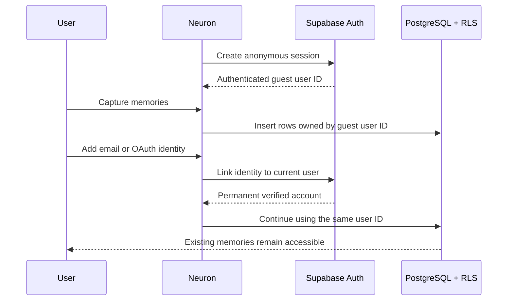

# Phase 2A Supabase Setup

The application code is ready for permanent accounts. Complete these dashboard steps in your Supabase project dashboard (`<your-project-ref>`).

## 1. Apply the Phase 2A migration

Open the Supabase SQL Editor, paste the contents of:

```text
supabase/migrations/20260719000100_initial_neuron.sql
```

Run it once. It is idempotent and can safely run after the original MVP schema. It adds:

- `public.profiles`
- Owner-only profile RLS
- Automatic profile creation for new Auth users
- Version-controlled definitions for the existing memories table

## 2. Configure redirect URLs

Open **Authentication → URL Configuration**.

For local development:

```text
Site URL: http://127.0.0.1:5173
Redirect URL: http://127.0.0.1:5173/**
```

Set `VITE_AUTH_REDIRECT_URL=http://127.0.0.1:5173` in `.env.local` so Neuron sends email and OAuth callbacks to the same allowed URL.

When production is deployed, add the exact HTTPS production URL and keep localhost only for development.

## 3. Verify email authentication

Email authentication is enabled by default in most Supabase projects. In **Authentication → Sign In / Providers → Email**, confirm:

- Email provider is enabled.
- Confirm email is enabled.
- Secure email change remains enabled unless you have a deliberate reason to change it.

Click the profile area at the bottom of the Neuron sidebar, enter an email, and open the confirmation link on the same browser.

## 4. Optional OAuth providers

The UI supports Google and GitHub, but each provider requires its own OAuth client credentials in Supabase. Leave the buttons unconfigured until credentials and production redirect URLs are ready.

For an anonymous user, Neuron calls identity linking so existing guest memories remain owned by the same Supabase user ID.

## 5. Verify

After the email link returns to Neuron:

- The sidebar changes from **Guest workspace** to the email username.
- The account dialog shows **Verified**.
- Existing memories remain visible.
- A capture survives sign-out and sign-in on another browser.

## Auth lifecycle


