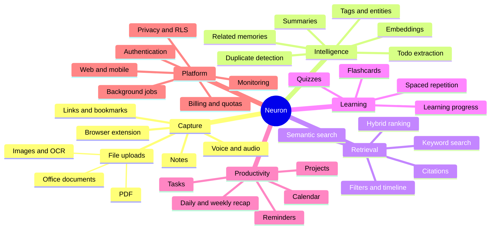
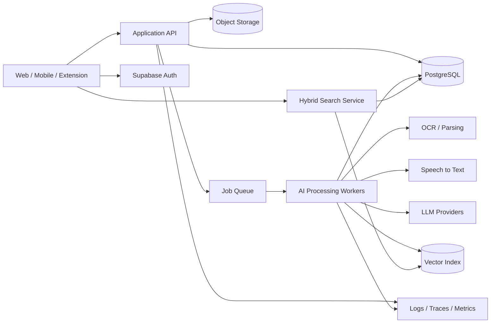
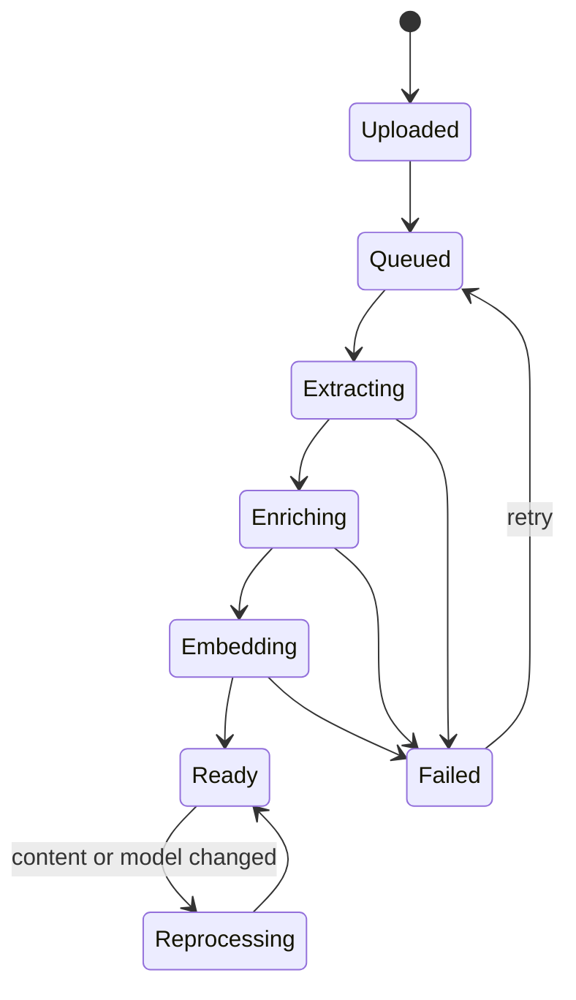
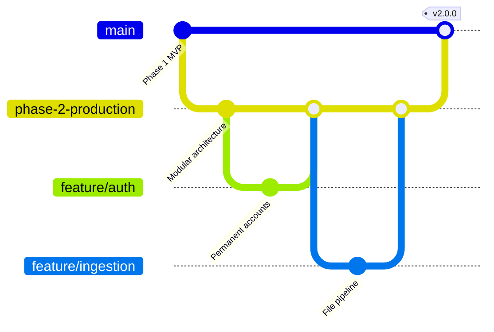

# Neuron Production Plan

This document turns the Phase 1 prototype into an implementation roadmap for a secure, observable, AI-powered production service.

## Product mind map



## Target architecture



## Memory processing lifecycle



## Delivery roadmap

### Phase 2A — Production foundation

Goal: make the MVP safe and maintainable for real users.

- [x] Add email magic-link and Google/GitHub authentication UI
- [x] Support anonymous-to-permanent account linking
- [ ] Add route protection for future private routes
- [x] Add session-aware profile and sign-out UI
- [x] Split database changes into versioned migrations
- [x] Add generated-shape database types and regeneration guidance
- [x] Add error boundaries and structured error messages
- [x] Add unit tests for data services and critical components
- [ ] Add integration tests for RLS policies
- [x] Add CI for type-check, tests, and build
- [ ] Add staging and production environments
- [ ] Add privacy policy, terms, account export, and account deletion

Exit criteria:

- Users can sign up, sign in, sign out, and recover access.
- One user cannot read or mutate another user’s data.
- Every merge is automatically type-checked, tested, and built.
- Production secrets exist only in managed secret stores.

### Phase 2B — Real universal capture

Goal: replace capture placeholders with durable ingestion.

- [x] Create a private object-storage bucket with owner-only policies
- [x] Add signed upload URLs and upload progress
- [x] Add MIME, extension, and size validation
- [x] Add URL, PDF, image, audio, text, and Office document processors
- [x] Add processing-state UI with retry controls
- [x] Store extracted text separately from original files
- [x] Add idempotency and duplicate detection
- [x] Add deletion cascades for source files and derived artifacts

Current Phase 2B foundation: browser uploads use short-lived signed URLs with real byte progress and cancellation, private files remain owner-scoped, ingestion jobs are claimed atomically, and the deployed Edge Function performs extraction/OCR/transcription/URL fetching. Results are saved as extracted text, summaries, and tags. Per-user SHA-256 fingerprints prevent duplicate files and canonicalized links, including concurrent-save races. Users can permanently delete a memory together with its private source file; database cascades remove its processing jobs and row-owned derived data. End-to-end provider validation remains.

Exit criteria:

- Supported content survives refresh and device changes.
- Failed processing is visible, diagnosable, and retryable.
- Deleting a memory removes its stored and derived data.

### Phase 2C — AI retrieval and chat

Goal: return grounded answers from the user’s own memory.

- [x] Generate embeddings in background jobs
- [x] Implement PostgreSQL full-text search
- [x] Add vector search with pgvector
- [x] Implement hybrid retrieval with reciprocal-rank fusion
- [ ] Add filters for type, collection, date, project, and people
- [ ] Add streaming assistant responses
- [x] Attach validated source citations to every generated answer
- [ ] Add model-provider abstraction and per-user preferences
- [ ] Add prompt/version tracking and evaluation datasets

Exit criteria:

- Search works with paraphrases and exact terms.
- AI answers cite only memories accessible to the active user.
- Retrieval quality is measured with a repeatable evaluation set.

### Phase 2D — Knowledge and learning tools

Goal: turn stored information into useful action.

- [ ] Add AI-generated collection rules (manual collections and membership are now persisted)
- [x] Derive people, organizations, technologies, dates, URLs, places, concepts, and source-backed relationships
- [x] Build an interactive graph from private memories and AI tags
- [x] Add owner-scoped entity storage and read API for relationship extraction
- [ ] Generate flashcards and quizzes
- [ ] Implement spaced-repetition scheduling
- [ ] Extract tasks and reminders with user confirmation
- [ ] Generate daily and weekly recaps

### Phase 3 — Scale and ecosystem

- [ ] Browser extension
- [ ] Mobile capture and offline sync
- [ ] Shared workspaces and permissions
- [ ] Email, calendar, Slack, GitHub, and cloud-drive connectors
- [ ] Billing, plans, usage limits, and abuse protection
- [ ] Regional deployment, backups, restore drills, and disaster recovery

## Recommended module evolution

```text
src/
├── app/                    # Providers, router, error boundaries
├── components/             # Reusable design-system components
├── features/
│   ├── auth/
│   ├── capture/
│   ├── memories/
│   ├── search/
│   ├── assistant/
│   ├── collections/
│   ├── graph/
│   └── learning/
├── hooks/                  # Reusable state and server hooks
├── lib/                    # Clients, configuration, telemetry
└── types/                  # Generated and shared types

supabase/
├── migrations/             # Versioned database changes
├── functions/              # Trusted server-side operations
└── tests/                  # Database and RLS tests
```

## Branch and release workflow



Branch rules:

1. `main` remains deployable.
2. Phase integration happens on `phase-2-production`.
3. Each feature or fix uses a short-lived branch.
4. Pull requests require type-check, tests, build, migration review, and security review where relevant.
5. Releases merge into `main` and receive a semantic version tag.

## Production data model additions

| Area | Tables or resources |
| --- | --- |
| Identity | `profiles`, `user_preferences` |
| Knowledge | `memories`, `memory_chunks`, `entities`, `memory_entities`, `memory_links` |
| Organization | `collections`, `collection_memories`, `projects` |
| Processing | `processing_jobs`, `processing_attempts`, `model_runs` |
| Learning | `flashcards`, `reviews`, `quizzes`, `quiz_attempts` |
| Productivity | `tasks`, `reminders`, `calendar_connections` |
| Files | Private storage buckets with ownership policies |

Every user-owned table must include an indexed `user_id` and tested RLS policies.

## Reliability and security gates

- RLS tests for select, insert, update, and delete
- Rate limits for auth, capture, search, and AI endpoints
- CAPTCHA or equivalent protection for anonymous onboarding
- Malware scanning and strict upload validation
- Encryption in transit and managed encryption at rest
- Structured logs without note contents, tokens, or private files
- Error tracking, traces, queue depth, latency, and model-cost dashboards
- Automated backups with scheduled restore tests
- AI prompt-injection defenses and citation validation
- Data export and permanent account-deletion workflows

## Definition of production-ready

- [ ] Authentication supports permanent accounts and recovery
- [ ] RLS and storage policies have automated tests
- [ ] Capture, processing, retrieval, and deletion work end to end
- [ ] AI answers include verified citations
- [ ] Accessibility meets WCAG 2.2 AA for primary workflows
- [ ] Mobile and desktop critical flows have end-to-end tests
- [ ] Staging mirrors production configuration
- [ ] Monitoring, alerts, backups, and incident procedures exist
- [ ] Privacy, retention, export, and deletion requirements are implemented
- [ ] Load and cost tests meet the agreed launch targets
