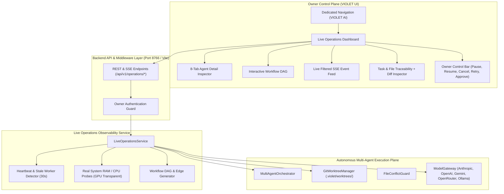

# VIOLET AI — Phase 3F Architecture: Live Operations & Agent Observability Center

## 1. System Vision & Objective

The **Live Operations & Agent Observability Center** is the real-time monitoring, telemetry, and owner control center for all AI agents, models, skills, tools, files, tasks, resource usage, and collaboration within VIOLET AI and VIOLET Lab.

Crucially, this system operates strictly against **authentic backend execution state** — eliminating simulated progress, mock data, or fabricated metrics.

---

## 2. Core Architectural Pillars

### 2.1 Navigation & Workspace Routing
The application routing and sidebar navigation seamlessly embed the VIOLET AI operational suite:
- **Overview**: High-level platform capabilities and health.
- **Multi-Model Intelligence**: Gateway routing, providers, preferences, latency, and cost audits.
- **Multi-Agent Lab**: Autonomous multi-agent pipeline setup and collaborative execution.
- **Agent Studio**: Agent persona authoring, prompt engineering, hyperparameter tuning, and skill/tool granting.
- **Live Operations**: Real-time telemetry, agent heartbeat monitoring, workflow DAG, live events, diff inspection, and owner controls.
- **Tasks & Timeline**: Complete history of executed autonomous and computer-use tasks.

### 2.2 Authentic Operations Overview Metrics
All dashboard overview statistics derive directly from aggregate task records, execution runs, and live worker states:
- **Total Registered Agents**: Real count of active and standby agent roles.
- **Active Running Agents**: Agents actively planning, implementing, reviewing, or testing whose heartbeats are fresh (`Δt <= 30s`).
- **Idle / Standby Agents**: Registered agents awaiting new task assignment.
- **Stale / Blocked Agents**: Workers whose heartbeats have stalled beyond the threshold while non-terminal.
- **Queued Tasks & Running Workflows**: Real-time task queue states.
- **Completed Tasks**: Successfully executed and reviewed task records.
- **Total Model Calls & Token Consumption**: Prompt and completion token aggregation across providers.
- **Estimated Provider Cost**: Real USD expenditure calculated from model pricing tables.

### 2.3 Live Agent Monitoring & Stale Worker Detection
Every agent card reports:
- Name and Role (`orchestrator`, `architect`, `developer`, `reviewer`).
- Current Goal and Task assignment.
- Exact Status (`idle`, `queued`, `planning`, `working`, `waiting`, `reviewing`, `completed`, `failed`, `cancelled`, `stale`).
- Provider and Model identifier (`anthropic:claude-3-5-sonnet`, `openai:gpt-4o`, `ollama:llama3.2`).
- Deployment Mode (`local` private vs `cloud`).
- Assigned skills (e.g. `architecture_design`, `code_implementation`, `diff_analysis`).
- Active tool permissions (`read_file`, `write_file`, `git_commit`, `run_test`).
- Isolated worktree branch and directory.
- Current activity description.
- Relative heartbeat indicator (Green pulse if `< 15s`, amber if `15–30s`, red warning badge if `> 30s` stale).
- Real elapsed execution duration.

### 2.4 8-Tab Agent Detail Inspector
Clicking an agent opens an inspector drawer with 8 distinct views:
1. **Overview**: Identity, role, assignment, run history, timestamps, token counts, cost.
2. **Skills**: Enabled skills with status (`ready`, `active`, `loaded`) and descriptions.
3. **Tools**: Granted tools, invocation counts, and recent execution history.
4. **Files**: Target files opened, modified, staged, or uncommitted.
5. **Model**: Temperature, max tokens, context window usage progress bar, average latency, and system prompt preview.
6. **Execution Logs**: Live filtered event log stream for the specific agent.
7. **Git**: Working branch, base branch, worktree path, latest commit SHA, insertions, and deletions.
8. **Communication**: Inter-agent messages sent and received, assistance requests, and review notes.

### 2.5 Real-Time Workflow DAG Visualization
Interactive directed acyclic graph (DAG) dynamically generated from task state:
- **Task Root Node**: High-level goal and execution state.
- **Subtask Nodes**: Topological stages (Architecture, Implementation, Quality Review) with dependency edges (`depends on`).
- **Agent Nodes**: Role assignments and model associations.
- **Review Cycle Nodes**: Reviewer verdicts (`APPROVED`, `CHANGES_REQUESTED`), scores, and cycle feedback loops.
- **Commit Nodes**: Git commits with SHAs, commit messages, and file change counts.
- **Integration Nodes**: Final prepared integration branches.

### 2.6 Live Unified Event Stream
High-throughput event feed streaming via Server-Sent Events (SSE) or filterable query:
- Filters: By Agent Role, Task ID, Event Type substring, or free-text search.
- Event categories: Task start/stop, model selection, skill load, tool invocation, file mutation, command execution, test execution, inter-agent messaging, code review verdict, commit creation, and system failures.

### 2.7 Hardware & Resource Telemetry
- **Host RAM**: Measured using Node.js `os.totalmem()` and `os.freemem()`.
- **Host CPU**: Measured using Node.js `os.loadavg()` and core count.
- **GPU / VRAM**: **Strictly transparent**. Explicitly displays `"Unavailable (No hardware telemetry provider connected)"` to avoid fabricating unmeasured metrics.
- **Provider Latency & Ollama Telemetry**: Measured average round-trip latency per provider and dedicated Ollama local inference timings.

### 2.8 Owner Controls & Safety Guardrails
- **Pause & Resume**: Owner can pause running workflows at cycle boundaries and resume when ready.
- **Cancel**: Aborts active processes, releases file conflict locks, and cleans up temporary worktrees.
- **Retry**: Re-initiates a failed task with fresh state.
- **View Diff**: Inline unified diff viewer with addition/deletion styling.
- **Approve Integration**: Merges the isolated integration branch into the base repository branch under explicit owner consent.
- **Destructive Confirmation**: Cancel, Retry, and Approve actions require modal confirmation.

---

## 3. Data Contracts & API Specification

### REST Endpoints
| Route | Method | Description |
|---|---|---|
| `/api/v1/operations/summary` | GET | Aggregated operations overview metrics |
| `/api/v1/operations/agents` | GET | List of all live and registered agents with heartbeat state |
| `/api/v1/operations/agents/:id` | GET | Detailed 8-tab inspector data for a specific agent |
| `/api/v1/operations/workflow/:taskId` | GET | Complete workflow DAG (nodes and edges) |
| `/api/v1/operations/resources` | GET | Hardware RAM/CPU metrics and provider latencies |
| `/api/v1/operations/events` | GET | Unified event stream (supports SSE via `Accept: text/event-stream`) |
| `/api/v1/operations/trace/:taskId` | GET | End-to-end task-to-commit traceability |
| `/api/v1/operations/diff/:taskId` | GET | Unified Git diff against base branch |
| `/api/v1/operations/tasks/:taskId/pause` | POST | Pause active task |
| `/api/v1/operations/tasks/:taskId/resume` | POST | Resume paused task |
| `/api/v1/operations/tasks/:taskId/retry` | POST | Retry failed or cancelled task |
| `/api/v1/operations/tasks/:taskId/cancel` | POST | Cancel active task execution |
| `/api/v1/operations/tasks/:taskId/approve` | POST | Merge integration branch into base branch |

---

## 4. Security & Isolation Architecture

1. **Owner Authentication Guard**:
   All `/api/v1/operations/*` endpoints require owner authentication via Bearer token (`VIOLET_API_TOKEN` or validated Supabase JWT matching the configured owner UUID/email).
2. **Worktree Isolation**:
   Git operations run exclusively in `.violet/worktrees/task-{id}/{role}` with path traversal checks (`assertPathInsideWorktree`).
3. **No Unsanctioned Push**:
   Integration approval performs local merges (`git merge {branch} --no-edit`); changes are never pushed to remote remotes without explicit command.
4. **Authentic Telemetry Only**:
   GPU status is honestly reported as unavailable whenever a physical telemetry probe is absent.
